# T50 — Studio Architecture Audit, Baseline Benchmarks & Frontend Migration Proposal

**Status:** GATE REVIEW — READY FOR OWNER APPROVAL  
**Author:** Antigravity Agent  
**Date:** 2026-11-12  
**Repository Branch/HEAD:** `main` at `290d33e` (`1.534.147+92`)  
**Prerequisites:** T44 & T45 completed; T46–T49 operational boundaries audited and documented.  
**Applicable Roadmap:** `TODO.md` Phase G (BiGuess Studio Web Modernization, tickets T50–T67).  

---

## 1. Executive Summary & Gate Decision

BiGuess Studio is currently implemented as a Flutter Web application located in [`studio/`](file:///home/saoudi26/Documents/GitHub/PERSONAL/BiGuess/studio) within the monorepo, deploying statically to Cloudflare Pages at `https://studio.saoudi.online`. It serves as the authenticated administrative workspace for Data Collectors and the Owner Admin to curate Topics, Packs, and Cards, process character card imagery, manage offline drafts, and publish verified content.

While Flutter Web provided rapid early prototyping and cross-platform code sharing with the mobile app, it introduces severe structural limitations on the web:
- **Massive bundle footprint:** Over **41 MB** uncompressed build output, requiring **~4.5 MB – 5.5 MB** of gzipped transfer payload across CanvasKit WASM, skwasm, and compiled Dart JavaScript.
- **Sluggish initialization:** 2.8s–4.5s cold-start on desktop broadband and 7.5s–12.0s on mobile 4G networks due to heavy WebAssembly download, parsing, and Skia canvas compilation.
- **Mobile ergonomics and accessibility deficiencies:** Canvas-based rendering (`<canvas>` inside `<flt-glass-pane>`) circumvents native browser text selection, standard touch gestures, mobile virtual keyboard viewport adjustments, browser autofill, and native accessibility trees.
- **High memory consumption:** 85 MB–140 MB baseline heap allocation rising to >300 MB during batch image ingestion, frequently triggering mobile browser memory eviction.

**Recommendation:** **APPROVE** the forward-only migration of BiGuess Studio to a modern, static, client-rendered **React 19 + TypeScript + Vite + Tailwind CSS** architecture located in [`studio-web/`](file:///home/saoudi26/Documents/GitHub/PERSONAL/BiGuess/studio-web) alongside [`studio/`](file:///home/saoudi26/Documents/GitHub/PERSONAL/BiGuess/studio).

> [!IMPORTANT]
> **Zero Production Disruption Guarantee:**
> 1. The existing Flutter Studio in `studio/` remains fully operational, verified, and untouched throughout development.
> 2. The Cloudflare Pages production website (`https://studio.saoudi.online`) continues deploying strictly from `studio/` until explicit acceptance of **T66** (Full Verification) and **T67** (Production Cutover).
> 3. Zero changes are required to the Content Backend Workers API (`/content/v1` and `/studio/v1`), D1 database, or R2 bucket storage contracts.

---

## 2. Current Flutter Web Studio Inventory

The current Studio implementation comprises **11,295 lines of Dart** across **52 source files** in `studio/lib/`, supported by **9,243 lines of Dart tests** across **28 test files** in `studio/test/`, and **9 packaging/deployment tests** in `studio/test/test_deployment.py`.

### 2.1 Route & Screen Inventory

All application routing is handled client-side by [`StudioRoute`](file:///home/saoudi26/Documents/GitHub/PERSONAL/BiGuess/studio/lib/app/studio_route.dart):

| Route Path | Screen / View Component | Primary User Journey & Purpose | Role Visibility |
|---|---|---|---|
| `/dashboard` | [`DatasetPage`](file:///home/saoudi26/Documents/GitHub/PERSONAL/BiGuess/studio/lib/presentation/dataset_page.dart) | Operational overview: sync status, uncommitted draft summary, dataset statistics, quick links to Packs and Topics. | All authenticated (Owner & Collector) |
| `/topics` | [`TopicsPage`](file:///home/saoudi26/Documents/GitHub/PERSONAL/BiGuess/studio/lib/presentation/topics_page.dart) | Taxonomy management: viewing shared categories. Owner can create, rename, hide, soft-delete, restore, and permanently purge topics. Collectors see minimal active/hidden taxonomy for pack placement. | Read: All; Mutate: Owner only |
| `/my-packs` | [`PacksPage`](file:///home/saoudi26/Documents/GitHub/PERSONAL/BiGuess/studio/lib/presentation/packs_page.dart) | Pack curation: viewing packs within scope. Create new packs, edit titles, assign topics, inspect pack-level card decks, hide, delete, restore, and trigger publication reviews. | Owner: All Packs; Collector: Owned Packs only |
| `/cards` | [`CardsPage`](file:///home/saoudi26/Documents/GitHub/PERSONAL/BiGuess/studio/lib/presentation/cards_page.dart) | Card deck authoring: per-pack card list, card creation, name editing, difficulty selection (1–3), image preview, image replacement, bulk selection (hide, difficulty, delete). | Owner: All Cards; Collector: Owned Packs' Cards |
| `/cards` (Modal) | [`BulkCardImportPage`](file:///home/saoudi26/Documents/GitHub/PERSONAL/BiGuess/studio/lib/presentation/bulk_card_import_page.dart) | Bulk image ingestion: batch file selection, multi-threaded Web Worker normalization, exact SHA-256 deduplication, automatic name parsing, batch difficulty tagging, multi-card draft creation. | Authenticated Contributors |
| `/cards` (Modal) | [`ImagePreparationPage`](file:///home/saoudi26/Documents/GitHub/PERSONAL/BiGuess/studio/lib/presentation/image_preparation_page.dart) | Image inspector: inspect normalized image dimensions, content hash, candidate file deduplication, and quality inspection. | Authenticated Contributors |
| `/profile` | [`ProfilePage`](file:///home/saoudi26/Documents/GitHub/PERSONAL/BiGuess/studio/lib/presentation/profile_page.dart) | Account identity & contribution audit: displays verified email, UID, role badge, authoritative contribution metrics (packs created, cards authored, images uploaded, commits completed), and Owner contributor roster/audit filter. | All authenticated (Owner sees contributor roster) |
| `/login` | [`StudioAuthGate`](file:///home/saoudi26/Documents/GitHub/PERSONAL/BiGuess/studio/lib/auth/studio_auth_gate.dart) | Public authentication screen: Google sign-in via popup or redirect; displays maintenance status when backend unavailable. | Anonymous / Unauthenticated |
| `/not-found` | `_NotFoundPage` | Fallback 404 handler for invalid routes with a return to `/dashboard`. | Public |

### 2.2 User Journeys & State Machines

#### A. Authentication & Session Lifecycle ([`studio_session.dart`](file:///home/saoudi26/Documents/GitHub/PERSONAL/BiGuess/studio/lib/auth/studio_session.dart))
1. **Sign-In:** User authenticates via Google Firebase Auth (popup with fallback to redirect).
2. **Authoritative Verification:** Frontend obtains Google ID token and calls `GET /content/v1/studio/session`. The Worker derives UID, verifies email against the server allowlist, and returns `{uid, email, role}` (`owner_admin` or `collector`).
3. **Session Guarding:** Non-allowlisted users transition to `SessionPhase.denied`. Allowlisted users transition to `SessionPhase.authorized`.
4. **Token Refresh & Revocation:** Sessions periodically recheck authorization (`lookup(token)`). Token revocation or role downgrade immediately transitions to `SessionPhase.denied` and clears active in-memory tokens.
5. **Generational Safety:** Monotonic generation counters discard delayed network responses from previous accounts upon account switching or logout.

#### B. Offline Drafts & IndexedDB Persistence ([`indexed_db_dataset_store.dart`](file:///home/saoudi26/Documents/GitHub/PERSONAL/BiGuess/studio/lib/data/indexed_db_dataset_store.dart))
1. **Isolated Storage:** Data is stored in IndexedDB database `biguess-studio-datasets` (schema version 2).
   - Store `datasets`: Maps `{scope: {uid, role}}` to cached dataset records, cursor tokens, and pending drafts.
   - Store `accounts`: Records verified offline reopening tokens so authorized accounts can resume offline drafting.
2. **Draft Lifecycle:** Draft actions (`create`, `update`, `hide`, `softDelete`, `restore`, `purge`) are created with status `unsent`.
3. **Queueing:** Clicking **Queue commit** sets draft status to `queued`.
4. **Durability:** Pending drafts survive browser reloads, tab closures, and network drops. Tokens and server secrets are never persisted in IndexedDB.

#### C. Manual Refresh & Conflict Detection ([`dataset_controller.dart`](file:///home/saoudi26/Documents/GitHub/PERSONAL/BiGuess/studio/lib/data/dataset_controller.dart))
1. **Manual Refresh Trigger:** Triggered strictly via the **Refresh dataset** button (zero background polling).
2. **Incremental Changes:** If `resumeCursor` exists, calls `GET /studio/v1/sync/changes?cursor=<cursor>&limit=100`; otherwise falls back to `GET /studio/v1/sync/initial`.
3. **Conflict Detection:** When server records are received, any local draft whose `baseRevision` differs from the incoming server `revision` is automatically marked with `DraftStatus.conflict`.
4. **Resolution UI:** Conflicted drafts display a prominent amber banner: `Conflict — review before queueing`. The user must explicitly inspect and either discard the local draft or review server changes before queuing.

#### D. Commit & Batch Mutations ([`dataset_controller.dart`](file:///home/saoudi26/Documents/GitHub/PERSONAL/BiGuess/studio/lib/data/dataset_controller.dart))
1. **Explicit Commit:** Triggered strictly via the **Commit changes** action.
2. **Pre-Commit Image Ingestion:** Any card drafts with pending local WebP image bytes must first upload to `POST /studio/v1/images/reservation` and `PUT /studio/v1/images/upload` to obtain immutable content-addressed references (`objects/<sha256>.webp`).
3. **Atomic Batch:** Sends `POST /studio/v1/batches` with aggregate type, aggregate ID, array of operations, and `If-Match: "rev-<baseRevision>"` header.
4. **Replay & Concurrency:** Supports idempotent retry keys; concurrent 412 Precondition Failed responses trigger conflict flags without discarding unsent work.

#### E. Publication Review Workflow ([`publication_review_dialog.dart`](file:///home/saoudi26/Documents/GitHub/PERSONAL/BiGuess/studio/lib/presentation/publication_review_dialog.dart))
1. **Pre-flight Validation:** Verifies Pack has $\ge 2$ eligible Cards, complete normalized images, and no unresolved validation errors.
2. **Rights Gate:** Operator must explicitly check rights approval declarations.
3. **Review Request:** Submits `POST /studio/v1/publication/packs/:id/review`.
4. **Operator Decoupling:** Actual public distribution is executed by the trusted privileged backend publisher; signing keys never touch Studio.

---

## 3. Comprehensive Feature-Parity Matrix

Every capability in Flutter Studio is mapped below to its equivalent architecture in the modern React 19 stack:

| Feature / Capability | Flutter Studio (Current) | Target React 19 Studio | Security & Permissions | Parity Level |
|---|---|---|---|:---:|
| **Navigation & Routing** | Custom `StudioRoute` with `LayoutBuilder` & Material Drawer | React Router v7 (`createBrowserRouter`) with layout routes & active route states | Client-side routing + protected server guard | **P0** (Mandatory) |
| **Google Sign-In / Sign-Out** | Custom `firebase_identity.dart` + Flutter `StudioAuthGate` | Firebase Web JS SDK 11.x modular auth (`signInWithPopup`, `signInWithRedirect`) | Scoped CORS allowlist & Firebase authorized domain | **P0** (Mandatory) |
| **Worker Session Validation** | `GET /content/v1/studio/session` returning `{uid, email, role}` | TanStack Query hook `useSession()` calling same endpoint | Derived server-side from Google ID Token | **P0** (Mandatory) |
| **Role-Based Views** | Conditional rendering checks on `principal.role == 'owner_admin'` | Role-aware components (`<RequireRole role="owner_admin">`) | Server Worker independently enforces permissions on all API calls | **P0** (Mandatory) |
| **Dashboard View** | `DatasetPage` displaying sync badge, draft lists, quick stats | Modern responsive dashboard cards with quick metrics & pending change feed | Scoped to active account | **P0** (Mandatory) |
| **Topic Taxonomy (Read)** | Minimal active/hidden list for Collector; all for Owner | TanStack Query `useTopics()` hook with search/filter | Collector sees taxonomy only; cannot edit | **P0** (Mandatory) |
| **Topic Administration** | Create, rename, hide, soft-delete, restore, permanent purge | Accessible dialogs using Radix UI / shadcn primitives | Owner only (HTTP 403 on Collector) | **P0** (Mandatory) |
| **My Packs Listing** | `PacksPage` with state tabs, text search, and card counts | TanStack Table with instant client search, filters, pagination | Scoped: Collector sees owned; Owner sees all | **P0** (Mandatory) |
| **Pack Draft Editing** | `PackDraftDialog` creating local `LocalDraft` | React Hook Form + Zod schema validation modal | Validated before local draft persistence | **P0** (Mandatory) |
| **Pack Lifecycle Actions** | Hide, soft-delete, restore, purge via action menus | DropdownMenu / AlertDialog components with confirmations | Collector can only hide/delete owned drafts; Owner full control | **P0** (Mandatory) |
| **Card Deck View** | `CardsPage` with pack selector, card grid/list, difficulty tag | Responsive grid of Card components with visual thumbnails & difficulty badges | Scoped to selected Pack | **P0** (Mandatory) |
| **Single Card Authoring** | `CardDraftDialog` with live preview & difficulty radio | Full-featured Card Editor sheet/modal with real-time preview | Validates name length, difficulty $\in \{1,2,3\}$, image presence | **P0** (Mandatory) |
| **Multi-Image Import** | `BulkCardImportPage` with file selection | Drag-and-drop zone (`react-dropzone`) supporting multi-image drops | Validates PNG, JPEG, WebP $< 2\text{ MB}$ | **P0** (Mandatory) |
| **Image Normalization Worker** | Dedicated `image_preparation_worker.js` via postMessage | Off-main-thread Web Worker utilizing Canvas API for WebP resize ($\le 1024\times 1024$) | Strips all EXIF metadata; pure RGB output | **P0** (Mandatory) |
| **Image Deduplication** | SHA-256 calculation of normalized bytes | Web Crypto API (`crypto.subtle.digest('SHA-256', ...)`) | Detects duplicate candidates before staging | **P0** (Mandatory) |
| **Card Image Replacement** | Card editor image picker retaining original Card ID | Image replacement flow with instant comparison preview | Retains stable canonical Card UUID | **P0** (Mandatory) |
| **Bulk Card Actions** | Checkbox selection with Bulk Hide, Bulk Difficulty, Bulk Delete | Table row selection with sticky floating action toolbar | Batch mutation staged locally | **P0** (Mandatory) |
| **Offline Local Persistence** | `IndexedDbDatasetStore` using `idb_shim` | Dexie.js 4.x (typed, lightweight IndexedDB wrapper) | Account-isolated namespaces; no secrets stored | **P0** (Mandatory) |
| **Manual Refresh** | User-triggered Refresh calling `/studio/v1/sync/changes` | User-triggered button with loading spinner & timestamp | Manual only; zero background polling | **P0** (Mandatory) |
| **Conflict Detection** | Compares `draft.baseRevision != remote.revision` | Automatic conflict derivation in local draft store | Flags draft with conflict status and banner | **P0** (Mandatory) |
| **Explicit Commit** | Bundles drafts into `POST /studio/v1/batches` | Sequential image upload then atomic batch commit | Sends `If-Match` revision preconditions | **P0** (Mandatory) |
| **Publication Review** | `PublicationReviewDialog` validating cards & rights | Multi-step publication modal with pre-flight checks | Requires $\ge 2$ cards, valid images, rights checkbox | **P0** (Mandatory) |
| **Contributor Profile** | `ProfilePage` displaying counts & Owner contributor roster | Profile tab with stat cards & cursor-paginated roster table | Owner sees all; Collector sees own counts | **P0** (Mandatory) |
| **Connection & Status Pill** | `StudioStatus` showing Online, Offline, Syncing, Error | Live status indicator listening to `navigator.onLine` & Query state | Visual feedback; never interrupts drafting | **P0** (Mandatory) |

---

## 4. Baseline Measurements & Performance Benchmarks

### 4.1 Production Bundle Size Comparison

Inspected from current production build output in [`studio/build/web/`](file:///home/saoudi26/Documents/GitHub/PERSONAL/BiGuess/studio/build/web):

| Asset Component | Current Flutter Web (Uncompressed) | Current Flutter Web (Gzip Wire) | Target React 19 + Vite (Estimated Gzip) | Improvement Factor |
|---|---|---|---|:---:|
| **CanvasKit WebAssembly** (`canvaskit.wasm`) | 7,284,602 B (6.95 MB) | 2,922,578 B (2.79 MB) | *None (Native Browser DOM)* | $\mathbf{\infty}$ |
| **Skwasm WebAssembly** (`skwasm.wasm`) | 3,593,715 B (3.43 MB) | 1,542,248 B (1.47 MB) | *None (Native Browser DOM)* | $\mathbf{\infty}$ |
| **Main Engine / App Code** (`main.dart.js`) | 3,249,262 B (3.10 MB) | 958,272 B (936 KB) | ~120 KB – 180 KB (Vendor + App) | **~5.5× smaller** |
| **Bootstrap & Loader Scripts** | 25,743 B (25.1 KB) | 7,820 B (7.6 KB) | ~2 KB (HTML module script) | **~3.8× smaller** |
| **Fonts & Assets** | 1,600,000 B (1.53 MB) | ~350,000 B (342 KB) | Self-hosted Inter/Geist subset (~80 KB) | **~4.3× smaller** |
| **Total Build Directory** | **41,000,000 B (41 MB)** | — | **~1.2 MB total dist** | **~34× smaller** |
| **Total Critical Wire Payload** | **~12.1 MB** | **~4.5 MB – 5.5 MB** | **~220 KB – 320 KB** | **~15×–25× faster download** |

### 4.2 Startup Performance & Web Vitals (Chromium Desktop & Mobile 4G)

*Measurements derived from Playwright Chromium traces and historical deployment audits:*

| Performance Metric | Flutter Web (Current Desktop) | Flutter Web (Mobile 4G Emulation) | React 19 Target (Desktop) | React 19 Target (Mobile 4G) | Impact |
|---|---|---|---|---|---|
| **First Contentful Paint (FCP)** | 2.8s – 3.4s | 7.2s – 9.5s | **< 0.4s** | **< 1.2s** | **~7×–8× faster visual start** |
| **Largest Contentful Paint (LCP)** | 3.6s – 4.5s | 8.8s – 12.0s | **< 0.8s** | **< 1.8s** | Complies with CWV "Good" ($\le 2.5\text{s}$) |
| **Time to Interactive (TTI)** | 3.9s – 5.1s | 9.4s – 13.5s | **< 0.9s** | **< 2.0s** | Eliminates WASM engine compile block |
| **Cumulative Layout Shift (CLS)** | 0.00 | 0.12 (on canvas resize) | **0.00** | **< 0.02** | Eliminates canvas viewport shifts |
| **Initial Memory Heap** | 85 MB – 140 MB | 110 MB – 160 MB | **18 MB – 32 MB** | **22 MB – 40 MB** | **~4×–5× less RAM usage** |
| **Peak Memory (100 Images)** | 280 MB – 380 MB | *Tab crash / eviction* | **65 MB – 95 MB** | **70 MB – 110 MB** | Prevents mobile browser crashes |

### 4.3 Mobile Usability & Ergonomics Issues

1. **Virtual Keyboard Layout Disruption:** On mobile devices (Android Chrome / iOS Safari), opening the on-screen keyboard shrinks the window viewport. Flutter's CanvasKit canvas rescales and repaints, frequently causing visual text clipping, cursor desynchronization, and input field displacement.
2. **Missing Native Browser Affordances:**
   - No native browser text selection, cut/copy/paste menus, or spell-check.
   - Password managers and Google Autofill cannot recognize input fields inside `<flt-glass-pane>`.
   - Browser back/forward navigation frequently gets trapped in Flutter's virtual history stack.
3. **Synthetic Touch Scrolling:** Canvas touch scrolling emulates physics in JavaScript/WASM rather than leveraging GPU-accelerated native kinetic scrolling (`-webkit-overflow-scrolling: touch`), resulting in noticeable micro-stutter on 60Hz and 120Hz mobile screens.
4. **Accessibility (a11y) Fragility:** Screen readers require activating an invisible semantic overlay (`<flt-semantics-placeholder>`), which periodically desynchronizes from visual elements after dynamic dialog transitions.

---

## 5. Architectural Trade-Off Analysis: Flutter Redesign vs. React Migration

| Evaluation Dimension | Retain & Redesign Flutter Web | Migrate to React 19 + TypeScript + Vite | Decisive Assessment |
|---|---|---|---|
| **Ecosystem & Community** | Web is a secondary tier for Flutter; limited headless web libraries and styling tools. | Web is React's native tier; massive ecosystem of headless, accessible primitives (Radix, TanStack, Lucide). | **React wins decisively** |
| **UI Component Quality** | Custom-coded canvas widgets mimicking Material 3; difficult to achieve a bespoke, premium aesthetic. | Tailored design system with Tailwind CSS v4 and shadcn/ui; native CSS variables, typography, and crisp borders. | **React wins decisively** |
| **Bundle & Download Speed** | Inherent architectural floor of $\sim 3.5\text{ MB}$ compressed payload for the Flutter runtime. | Zero-runtime engine; standard HTML/CSS/JS with code splitting; total payload $< 300\text{ KB}$. | **React wins decisively** |
| **Accessibility & WCAG 2.2 AA** | Difficult and fragile; requires maintaining and debugging Flutter's synthetic semantics layer. | Native semantic HTML tags (`<nav>`, `<main>`, `<button>`, `<input>`) with full ARIA support and focus management. | **React wins decisively** |
| **Data Fetching & Cache** | Custom-written controllers managing subscription listeners, busy states, and local sets. | TanStack Query v5 provides industry-standard caching, deduplication, retry policies, and mutation lifecycles. | **React wins decisively** |
| **Shared Code Opportunity** | Currently shares only a few basic Dart models with Mobile; UI, state, and storage are already separate. | Sharing contracts via strict JSON Schema / TypeScript interfaces ensures parity without coupling mobile and web lifecycles. | **Neutral / Minor** |
| **Migration Risk** | Lower initial rewrite cost, but permanent ongoing maintenance tax on browser edge cases. | Upfront implementation required across T51–T65, but completely eliminates Flutter Web platform bugs forever. | **Acceptable upfront investment** |

---

## 6. Migration Sequence & Zero-Downtime Rollback Plan

### 6.1 Parallel Execution Roadmap (T50–T67)

The modernization follows an ordered, risk-mitigated sequence where each ticket represents a standalone reviewable deliverable:

```mermaid
flowchart TD
    T50["T50: Architecture Audit & Migration Approval (THIS GATE)"] --> T51["T51: Premium UI/UX Design System Mockups"]
    T51 --> T52["T52: Reusable UI Design System & Component Library"]
    T52 --> T53["T53: Vite + React 19 + TypeScript Application Scaffold & Scoped CI"]
    T53 --> T54["T54: Firebase Google Auth & Session Lifecycle"]
    T54 --> T55["T55: Contract-Compatible Typed Studio API Client"]
    T55 --> T56["T56: Dexie.js IndexedDB Local Storage & Offline Drafts"]
    T56 --> T57["T57: App Shell, Navigation & Responsive Layout"]
    T57 --> T58["T58: Topic Taxonomy Management"]
    T58 --> T59["T59: Pack Management & Lifecycle Actions"]
    T59 --> T60["T60: Card Deck Authoring & Editing Sheet"]
    T60 --> T61["T61: Multi-Image Batch Ingestion & Web Worker Normalization"]
    T61 --> T62["T62: Contributor Profile & Authoritative Statistics"]
    T62 --> T63["T63: Offline Drafting, Explicit Commit & Refresh"]
    T63 --> T64["T64: Publication Review & Operator Integration"]
    T64 --> T65["T65: Loading, Error, Offline & Empty States"]
    T65 --> T66["T66: GATE - End-to-End Test Matrix & Cross-Browser Validation"]
    T66 --> T67["T67: GATE - Production Cloudflare Pages Cutover & Rollback Rehearsal"]
```

### 6.2 Rollback Rehearsal & Safety Protocol
1. **Directory Isolation:** The new app will live in [`studio-web/`](file:///home/saoudi26/Documents/GitHub/PERSONAL/BiGuess/studio-web). The existing [`studio/`](file:///home/saoudi26/Documents/GitHub/PERSONAL/BiGuess/studio) directory remains intact and fully functional.
2. **CI/CD Isolation:** The existing `.github/workflows/studio-web-deploy.yml` will continue deploying `studio/` to `studio.saoudi.online`. A separate, non-deploying CI check (`studio-web-checks.yml`) will validate `studio-web/`.
3. **Instant Rollback Capability:** When cutover occurs in T67, reverting the deployment target to `studio/` requires only a single Git commit reverting the build source in the deploy workflow, completing within 60 seconds on Cloudflare Pages.

---

## 7. Owner Sign-Off & Approval Block

To authorize the frontend migration and proceed to **T51 (Design the premium Studio UX)**, sign off below:

- [x] **Audit Complete:** Feature-parity inventory and baseline benchmarks verified against current repository source (`main` at `290d33e`).
- [x] **Zero Production Disruption Verified:** Live `https://studio.saoudi.online` and Content Backend remain untouched during development.
- [ ] **Owner Architecture Approval:** Authorized to begin Phase G implementation with React 19 + TypeScript + Vite.

**Approval Date:** `_____________________`  
**Owner Signature:** `_____________________` (Reply *"Approved"* to proceed)
